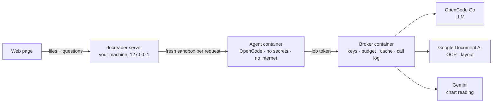

# docreader

**Agents that read your documents.**
Give docreader your files and a question. An AI agent gets a toolbox and a sandbox, and it decides how to read each document: which tool to use, where to look, what to extract and when it has enough. No fixed pipeline. You watch every step and its cost.


## Why agents

Real documents do not fit one pipeline. A contract is clean text, an invoice is a scan, a quality report is a 7-page Power BI export full of charts, and a lab workbook hides its values under merged headers. A fixed "extract, then answer" pipeline breaks on each of these in a different way.

docreader gives the job to an agent instead. For each request it:

1. **Looks** at what it received: file types, page counts, whether the PDF has text.
2. **Plans** the cheapest route to the answer, and goes straight to the pages, sheets or charts that matter.
3. **Builds** what it needs on the fly: a Python script for a workbook, a crop of one chart, an OCR pass on two scanned pages.
4. **Checks** its own answer against each question, looks again where something is missing, and says what it could not find.

## The agent's toolbox

| Kind                               | Tools                                                                                                                   | Cost            |
| ---------------------------------- | ----------------------------------------------------------------------------------------------------------------------- | --------------- |
| Code                               | Python 3 with openpyxl, xlrd, pandas, numpy, duckdb, python-docx, python-pptx, pypdf, pdfplumber, PyMuPDF, Pillow, lxml | Free            |
| PDF                                | poppler (`pdftotext`, `pdfinfo`, `pdftoppm`, `pdfimages`), MuPDF (`mutool`)                                             | Free            |
| OCR                                | tesseract (English, Spanish)                                                                                            | Free            |
| Shell                              | `grep`, `sed`, `awk`, `jq`, `file`, `unzip`                                                                             | Free            |
| Cloud OCR (`ocr_pages`)            | Google Document AI, Enterprise OCR, on the pages the agent picks                                                        | $0.0015 / page  |
| Layout and tables (`parse_layout`) | Google Document AI Layout Parser, for tables with merged cells                                                          | $0.01 / page    |
| Vision (`describe_figure`)         | Gemini reads a chart, diagram or picture, or a crop the agent made                                                      | ≈ $0.002 / call |

The agent chooses. It uses the free tools first and pays for a cloud tool only when the local view is not enough.

## What you get

- **Any document.** PDF (text or scanned), Excel, Word, CSV, PowerPoint, images.
- **Two modes.** Ask questions and get answers with their sources, or convert documents to structured Markdown or JSON.
- **Glass box.** See the agent's thinking, every command with its input and output, and a live cost meter for the model and each paid tool.
- **Answers you can check.** Each source the agent lists is labelled after a quick code check against the original file.
- **Safe by design.** Each request runs in a fresh container with no secrets, no internet and read-only inputs. One broker holds every key and enforces the budget.

## Quick start

You need Node 24, pnpm and Docker.

```sh
cp .env.example .env    # then set OPENCODE_API_KEY and BROKER_ADMIN_TOKEN
pnpm install
pnpm start
```

Open **http://127.0.0.1:7800**.

The first `pnpm start` builds the agent image, the broker image and the web page, which takes a few minutes. Later starts take seconds. Press Ctrl+C to stop: the running sandboxes and the broker are removed.

To make a `BROKER_ADMIN_TOKEN`, run `openssl rand -hex 32`. The Google tools are optional: see [Google tools](#google-tools).

## Using docreader

1. **Drop documents** on the page.
2. **Choose a mode:**
   - **Ask questions:** write one question per line.
   - **Convert to structured:** choose Markdown or JSON, and add instructions if you want ("only the tables", "one section per month"). You get one file per document, with a preview and a download link.
3. **Choose a model, a budget and a privacy option.**
   - The default model is the cheapest fast one (see [Models and cost](#models-and-cost)).
   - The budget caps one request: model calls and paid tools together.
   - **Keep documents on this machine** turns off the Google tools. Model calls still leave the machine.
4. **Watch it work.**
   - **Agent activity** shows its thinking, each tool call (click one for the input and output) and its messages.
   - **Usage** shows the model's calls, tokens and cost, plus each paid tool call with its pages, time and cost. It updates during the run.

### Can I trust the answer?

In Ask mode, the agent lists the sources it used. A quick code check against the original file then labels each source:

| Label                 | Meaning                                                |
| --------------------- | ------------------------------------------------------ |
| Checked               | The quote or the cell values are where the agent said  |
| Checked (other place) | Found, but on another page                             |
| Place found           | The place exists; the agent gave nothing to compare    |
| Not found             | Not there. Check this part of the answer yourself      |
| Image reading         | A model read it from a chart or picture; not checkable |

The labels are advisory. They never block or change an answer. The agent also re-reads each question before it stops, and says what it could not find.

## Models and cost

docreader uses [OpenCode Go](https://opencode.ai/docs/go/) models. Measured on real documents (2026-11-15):

| Model                     | Spreadsheet question | Chart in a 7-page PDF | Notes                                     |
| ------------------------- | -------------------- | --------------------- | ----------------------------------------- |
| **deepseek-v4.1-flash** ★ | 42 s · $0.004        | 291 s · $0.032        | Default. Best cost and speed on hard work |
| glm-5.3-flash             | 26 s · $0.004        | 749 s · $0.079        | Fastest on simple lookups                 |
| minimax-m3.1-flash        | 36 s · $0.010        | 397 s · $0.098        | Correct, about 3× the cost                |

All three answered correctly. Google tool prices are in `config/prices.json`; a chart reading costs about $0.002.

## How it works



For each request, the server:

1. Copies the documents into a new job folder and registers the job with the broker. The broker returns a token and holds the budget.
2. Creates a private Docker network that reaches only the broker, and starts a hardened agent container on it.
3. Streams the agent's events and the broker's spend to the page as they happen.
4. Reads the answer or the converted files, labels the sources, revokes the token, and removes the container and the network.

| Guarantee                 | How                                                                                                                       |
| ------------------------- | ------------------------------------------------------------------------------------------------------------------------- |
| The agent holds no secret | It gets a one-request token. Every key is in the broker.                                                                  |
| No internet for the agent | Its only network is an internal Docker network shared with the broker. The broker's admin API is not reachable from it.   |
| Inputs cannot be changed  | Documents are mounted read-only. The agent writes only to its own output folder.                                          |
| Spend is capped           | The broker refuses any model or tool call that would pass the budget, and caches tool results by file hash.               |
| Hardened container        | Non-root user, read-only root file system, no capabilities, `no-new-privileges`, CPU, memory and process limits, timeout. |
| Everything is recorded    | `jobs/<id>/` holds the result, every agent event, every model and tool call with its cost, and the agent's output files.  |

## Configuration

All settings go in `.env` (read only by the broker) or in the server's environment.

| Setting                 | Default               | Purpose                                                                                                |
| ----------------------- | --------------------- | ------------------------------------------------------------------------------------------------------ |
| `OPENCODE_API_KEY`      | required              | OpenCode Go key                                                                                        |
| `BROKER_ADMIN_TOKEN`    | required              | Secret between the server and the broker                                                               |
| `DOCREADER_MODEL`       | `deepseek-v4.1-flash` | Default model on the page                                                                              |
| `DOCREADER_TIMEOUT_MIN` | `15`                  | Time limit per request                                                                                 |
| `DOCREADER_JOBS_DIR`    | `./jobs`              | Job folders. Must be a path Docker can mount: your home folder works, system temp folders often do not |
| `DOCREADER_RUNTIME`     | `runc`                | Container runtime. Use `runsc` for gVisor on Linux                                                     |

Names, ports, limits and the model list live in one file: `src/shared/constants.ts`.

### Google tools

The OCR, layout and chart tools need a Google Cloud project:

1. Enable the Document AI API and the Vertex AI API.
2. Create an **Enterprise Document OCR** processor and a **Layout Parser** processor in one location (`eu` or `us`).
3. Create a service account with only `roles/documentai.apiUser` and `roles/aiplatform.user`. Save its JSON key as `secrets/gcp-key.json`.
4. In `.env`, set `GCP_PROJECT`, `DOCAI_LOCATION` (the processors' location), `DOCAI_OCR_PROCESSOR_ID` and `DOCAI_LAYOUT_PROCESSOR_ID`.
5. Set a billing budget alert on the project.

`VERTEX_LOCATION=global` works everywhere but does not keep processing in the EU. Use an EU region if your project serves the Gemini model there.

## Development

| Command          | What it does                                                      |
| ---------------- | ----------------------------------------------------------------- |
| `pnpm start`     | Build what is missing, start the broker, serve the page           |
| `pnpm build`     | Rebuild both images and the page. Run it after you change code    |
| `pnpm dev:ui`    | Page with hot reload on port 5173. It needs `pnpm start` running  |
| `pnpm check`     | Everything below, in order                                        |
| `pnpm typecheck` | TypeScript, strict                                                |
| `pnpm lint`      | oxlint                                                            |
| `pnpm format`    | oxfmt. `pnpm format:check` only reports                           |
| `pnpm knip`      | Unused files, exports and dependencies                            |
| `pnpm test`      | Node's test runner: broker, tools, server helpers, source checker |

```
src/
  server/   HTTP API, one sandbox per request, live events, cleanup
  ui/       React page: upload, modes, live activity, usage, results
  agent/    Container entrypoint, prompts, source checker (Python)
  broker/   Keys, LLM proxy, budget, paid tools, cache, call log
  shared/   Constants, types, process helper
docker/     agent and broker images
config/     Google tool prices
samples/    Documents to try
test/       Tests
```

TypeScript runs directly on Node 24 (type stripping): no build step for the server or the broker.

The source checker tests need Python with `openpyxl` and `python-docx`. Make the environment once:

```sh
uv venv .venv && uv pip install --python .venv/bin/python openpyxl python-docx
```

## Troubleshooting

| Symptom                                        | Fix                                                                                               |
| ---------------------------------------------- | ------------------------------------------------------------------------------------------------- |
| `bind source path does not exist`              | Put `DOCREADER_JOBS_DIR` under your home folder. Your Docker engine does not share that path      |
| Google tools fail with `invalid_rapt`          | The credentials are a personal `gcloud` login that expired. Use a service account key (see above) |
| Google tools fail with `404 ... was not found` | That Gemini model is not served in `VERTEX_LOCATION`. Try `global`                                |
| Answers are slow                               | Give Docker more resources (for example 4 CPUs and 8 GB). Each sandbox can use up to 4 GB         |
| "The budget ran out"                           | Raise the budget on the page, or ask fewer questions per request                                  |
| The page says it is not built                  | Run `pnpm build`                                                                                  |

## Limitations

- Broker state (tokens, spend) is in memory. Restarting the broker ends the running requests.
- The budget check runs before each model call, so one call can pass the budget by its own cost.
- Source labels check quotes and cell values, not the reasoning. A wrong conclusion drawn from correct sources is not detected.

## License

[MIT](LICENSE) © 2026 Alejandro Sanchez
